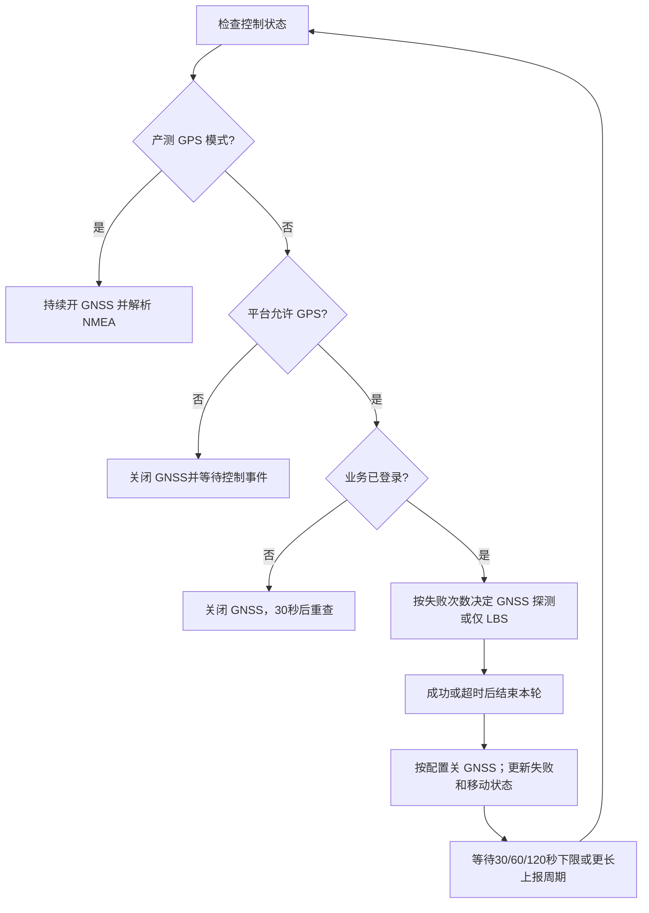

# Shanli 低功耗代码导读与 Broad 移除方案

本文回答三个问题：Shanli 当前如何控制功耗；Broad 与音频、GPIO、网络有什么关系；如果替换 Broad，怎样保留已有硬件功能。

分析日期：2026-11-04。应用代码基线：`f93851d`，分支 `codex/tcpudp-domain`；原始应用行为对照：`9976d97`。本文是代码分析和后续实施方案，**没有执行 Broad 删除，也没有改变当前固件行为**。音频采集、播放和 TTS 的详细调用链见配套文档 [Shanli 音频代码导读](shanli_audio_code_guide.md)。

**先看结论：当前版本仍请求禁止自动睡眠，运行每 3 秒一次的 TCP/UDP 网络诊断，暂停 Broad 应用登录但保留 Broad 内核初始化。它不是原始低功耗配置。GNSS 省电策略主要在可读应用源码中；Broad 新库内还能看到音频调频、软件定时器和业务空闲判断，但不能据此断言设备当前旧内核已经进入某种低功耗状态。**

## 1. 阅读范围与证据分级

本文用“代码事实”表示能直接由当前源码或指定版本反汇编确认的行为；“推断”表示基于这些行为得出的解释；“建议”表示尚未实施的方案。设备是否真的睡眠、实际电流多少、深睡后能否被某个 GPIO 唤醒，都需要实测。

| 对象 | 证据范围 | 使用限制 |
|---|---|---|
| 当前应用源码 | `f93851d` 下的 `ql-sdk-feature-shanli/ql-application/threadx/` | 可说明当前构建配置和代码路径；不能替代运行测量。 |
| 原始应用源码 | `9976d97` | 用于辨别原始允许睡眠配置与当前诊断改动。 |
| SDK 内核 `broad.lib` | 库中版本字符串为 `5.0.4-20260812-release` | 本文 Broad 反汇编结论仅对应这份库。 |
| 当前打包的预编译 `kernel.bin` | 已识别 Broad 版本字符串为 `5.0.4-20251022-release`，与设备日志一致 | **不是上述新库的同一版本**；不能把新库所有函数行为直接写成此镜像的运行行为。 |
| `quectel-build.lib:ql_platform.o` | SDK 平台层实现 | 用于解释 `ql_cpu_fre_set`；它不属于 Broad 库，不能标作 Broad 的版本实现。 |

版本、镜像和散列记录见 [镜像来源证据](evidence/broad-analysis-20261104/image_provenance.txt)。反汇编摘录保留了对象名、函数名、原始 `OFFSET` 和重定位信息；函数提取后的显示地址从零开始，不是最终固件运行地址。常量池可能被反汇编器显示成指令，不能当作执行路径解释。

建议阅读顺序：先读 [`example_lpm.c`](../ql-sdk-feature-shanli/ql-application/threadx/interface/driver/example_lpm.c#L15)，再读 [`example_uart.c`](../ql-sdk-feature-shanli/ql-application/threadx/interface/driver/example_uart.c#L45) 的 GNSS 状态机，最后读 [`example_poc.c`](../ql-sdk-feature-shanli/ql-application/threadx/interface/poc/example_poc.c#L922) 的启动依赖和本文第 6～8 节。

## 2. 把几种“省电”机制分开理解

| 机制 | 本项目中的代表代码 | 能说明什么 | 不能据此说明什么 |
|---|---|---|---|
| 任务休眠／阻塞等待 | `ql_rtos_task_sleep_ms/s()`、事件或队列等待 | 当前线程让出执行机会，避免持续忙轮询。 | 整颗芯片已进入深睡、射频已休眠。 |
| 自动睡眠许可 | `ql_autosleep_enable(QL_ALLOW_SLEEP)` | 向平台开放自动睡眠条件。 | 调用后立即睡眠、一定达到某个电流值。 |
| 睡眠锁／睡眠标志 | `ql_lpm_wakelock_*`、`ql_sleep_flags_*` | 活跃模块可以参与平台睡眠约束。 | 任意同名 Broad OEM 接口都真正接到了这些 SDK 锁。 |
| CPU 频率控制 | `ql_cpu_fre_set()` | 改变或解除特定 CPU 频率约束，具体看参数实现。 | 与系统睡眠锁等价，或者等于蜂窝 PSM。 |
| 外设断电 | GNSS 电源 GPIO、PA GPIO | 能停止对应外设的供电／使能请求。 | LTE 模组、MCU、其他外设同时断电。 |
| 蜂窝 PSM／eDRX | 本次检查的应用路径未发现显式 PSM/eDRX 配置 | 当前没有足够应用代码证据说明已配置这类蜂窝省电机制。 | 不能由 `autosleep`、Broad `power_mode` 或 `task_sleep` 推导出 PSM 已启用。 |

睡眠枚举和 API 声明在 [`ql_power.h:62`](../ql-sdk-feature-shanli/ql-application/threadx/common/include/ql_power.h#L62)、[`ql_power.h:147`](../ql-sdk-feature-shanli/ql-application/threadx/common/include/ql_power.h#L147)。`ql_autosleep_enable()` 返回 `void`，所以当前日志刻意记录的是“requested”，不是可验证的睡眠成功状态。

SDK 平台库还提供了更具体的门控证据：[`ql_autosleep_enable():77`](evidence/broad-analysis-20261104/ql_power.disasm.txt#L77) 保存全局允许标志，然后进入 [`_ql_system_sleep_flags_check():49`](evidence/broad-analysis-20261104/ql_power.disasm.txt#L49)。当全局禁止，或者已登记睡眠标志组存在非零标志时，请求禁止睡眠；全局允许且相关标志均清零时才请求允许。下层 [`ql_sleep_flag_set():27`](evidence/broad-analysis-20261104/ql_power.disasm.txt#L27) 对比现有状态，必要时调用 `quec_qsclk_cmd_msg_send`。这解释了为什么“允许自动睡眠”只是门控条件；它没有提供芯片此刻已经睡着的证明。该对象来自核验过的 SDK `quectel-build.lib`，仍须保持与旧运行内核的版本边界。

## 3. 原始设计与当前网络诊断版的差别

### 3.1 这次 sleep 修改到底改了什么

原始 `9976d97` 中，`ql_power_test2()` 请求：

```c
ql_autosleep_enable(QL_ALLOW_SLEEP);
```

原始文件留存于 [original_example_lpm.c:14](evidence/broad-analysis-20261104/original_example_lpm.c#L14)。当前 [`example_lpm.c:15`](../ql-sdk-feature-shanli/ql-application/threadx/interface/driver/example_lpm.c#L15) 请求：

```c
ql_autosleep_enable(QL_NOT_ALLOW_SLEEP);
```

这个改动用于 ACK 问题的对照实验：减少自动睡眠这一变量，观察网络接收是否变化。它没有把所有 `ql_rtos_task_sleep_*()` 去掉；各任务仍然会休眠或阻塞，调度器仍会运行其他线程。它也没有删除 Broad、停用 GNSS 状态机或者主动设置蜂窝 PSM。

当前生效的是 [`application_init(ql_power_test2, ...)`](../ql-sdk-feature-shanli/ql-application/threadx/interface/driver/example_lpm.c#L123)。同文件的 wakelock 计数示例、GPIO0 唤醒示例虽有完整函数体，但任务注册被注释；20 秒切换睡眠标志的循环也被注释。**存在示例代码不代表当前在执行。**

建议在网络链路问题定位结束后，将允许睡眠的恢复作为独立提交和实测项；不要在同一轮同时改变 APN、服务器、心跳周期、Broad 登录和睡眠配置，否则难以判定是哪一项造成变化。

### 3.2 当前还有哪些会改变功耗的诊断配置

[`lte_tcpudp_heartbeat.h:5`](../ql-sdk-feature-shanli/ql-application/threadx/interface/poc/lte_tcpudp_heartbeat.h#L5) 配置目标 `sip.paitalk.com`，间隔为 3 秒，版本标记 `v0.4-domain-no-autosleep`，诊断日志开启。周期性网络发送和日志增加了活动机会；这只是代码层面的影响判断，不能换算成未经测量的平均电流。

[`example_poc.c:34`](../ql-sdk-feature-shanli/ql-application/threadx/interface/poc/example_poc.c#L34) 默认 `POC_INTERCOM_LOGIN_ENABLE=0`。当前不会按正常路径登录 Broad；[`PTT 事件处理`](../ql-sdk-feature-shanli/ql-application/threadx/interface/poc/example_poc.c#L1011) 也在此模式下丢弃事件。因此“按键没有进入正常对讲”不能直接判断为 GPIO 坏了。

原 POC 任务使用 [`40 秒事件等待超时`](../ql-sdk-feature-shanli/ql-application/threadx/interface/poc/example_poc.c#L912)，空闲超时且已登录时发送 `broad_send_ping()`，每 3 次相关循环查询／上报终端状态；见 [`example_poc.c:1062`](../ql-sdk-feature-shanli/ql-application/threadx/interface/poc/example_poc.c#L1062)。实际条件是 `POC_INTERCOM_LOGIN_ENABLE && ret != 0 && g_login_ok`，因此等待 API 的其他失败返回也可能进入该分支，代码未专门区分超时和错误。正常等待下它是**空闲超时驱动**，不是严格每 40 秒／120 秒的绝对时钟任务；有其他事件会影响节奏。当前登录开关为 0，该 POC 分支默认不执行。它与独立的 3 秒 TCP/UDP heartbeat 是两套逻辑。

## 4. GNSS：应用里最清晰的外设省电策略

### 4.1 状态机和硬件供电

GNSS 代码位于 [`interface/driver/example_uart.c`](../ql-sdk-feature-shanli/ql-application/threadx/interface/driver/example_uart.c#L27)。本次比对中该文件相对 `9976d97` 没有差异，因此这套退避逻辑来自既有应用，并非此次 TCP/UDP 诊断新增。



图表示业务判断关系，不表示所有状态都能被控制事件立即打断。

当前板型 [`e02t_board_cfg.h:12`](../ql-sdk-feature-shanli/ql-application/threadx/common/include/e02t_board_cfg.h#L12) 启用新板配置，GNSS 电源为 GPIO17，复位为 GPIO5，`E02T_GPS_KEEP_ON=0`。[`gps_power_en():391`](../ql-sdk-feature-shanli/ql-application/threadx/interface/driver/example_uart.c#L391) 开启时先拉高复位、等待 1ms，再拉高电源；关闭时先拉低复位、等待 1ms，再拉低电源。这里描述的是代码执行顺序，实际电源电路含义仍应与原理图对应。

### 4.2 退避参数按代码解读

核心参数在 [`example_uart.c:57`](../ql-sdk-feature-shanli/ql-application/threadx/interface/driver/example_uart.c#L57)，定位窗口选择在 [`gps_fix_timeout_ms():76`](../ql-sdk-feature-shanli/ql-application/threadx/interface/driver/example_uart.c#L76)，轮间等待在 [`gps_sleep_s():92`](../ql-sdk-feature-shanli/ql-application/threadx/interface/driver/example_uart.c#L92)。

| 连续 GNSS 失败计数 | 本轮 GNSS 策略 | 单次允许定位时间 | 本轮后的等待下限 |
|---|---|---|---|
| 0 | 正常开启 GNSS | 240 秒 | `max(平台上报周期, 30秒)` |
| 1～2 | 每轮仍探测 GNSS；失败后尝试 LBS | 120 秒 | `max(平台上报周期, 60秒)` |
| ≥3 | 以 LBS 为主；移动或周期条件满足时探测 GNSS | 通常 120 秒；失败计数为 5 的倍数时给 240 秒窗口 | `max(平台上报周期, 120秒)` |

这里的时间是**本轮定位窗口和轮间等待**，不是严格端到端上报周期；定位、LBS 查询和上传本身也耗时。源码注释说每次上电为冷启动，但是否保留星历需要结合实际 GNSS 模块和供电电路核实，不能仅凭注释推广到所有硬件。

[`阶段二判断:593`](../ql-sdk-feature-shanli/ql-application/threadx/interface/driver/example_uart.c#L593) 使用 `g_lbs_cycle_cnt % 5 == 0` 安排周期探测。计数从 0 开始，因此进入阶段二的第一轮就可能探测，不是先等待满 5 轮。LBS 经度或纬度绝对差超过 `0.005` 度时，设置标志在**下一轮**安排 GNSS；这是粗略坐标变化判定，不是精确的 500 米距离计算，见 [`移动检测:720`](../ql-sdk-feature-shanli/ql-application/threadx/interface/driver/example_uart.c#L720)。

[`本轮结束:666`](../ql-sdk-feature-shanli/ql-application/threadx/interface/driver/example_uart.c#L666) 停止定位定时器，按 `E02T_GPS_KEEP_ON` 关闭 GNSS；成功清零失败计数和阶段二周期计数，只有确实开启过 GNSS 且失败才增加失败计数。

### 4.3 不能忽略的例外和耦合

平台未启用定位时，代码在 [`529`](../ql-sdk-feature-shanli/ql-application/threadx/interface/driver/example_uart.c#L529) 关闭 GNSS、无限等待控制事件；未登录时在 [`575`](../ql-sdk-feature-shanli/ql-application/threadx/interface/driver/example_uart.c#L575) 关闭 GNSS并每 30 秒重新检查。产测分支在 [`543`](../ql-sdk-feature-shanli/ql-application/threadx/interface/driver/example_uart.c#L543) 持续供电、解析 NMEA，不执行普通业务的成功／超时关闭流程；测量待机功耗前要先退出此模式。

轮末 [`743`](../ql-sdk-feature-shanli/ql-application/threadx/interface/driver/example_uart.c#L743) 直接调用 `ql_rtos_task_sleep_ms(sleep_s * 1000)`。不能因为其他地方有 `QL_GPS_CTRL_FLAG`，就认为平台修改配置一定立即打断这段普通任务等待。LBS 检测到移动后的“立即探测”也应理解为下轮判断时触发。

实际开关是 `g_is_gps_open`；[`ui_request_location_change():562`](../ql-sdk-feature-shanli/ql-application/threadx/interface/poc/example_poc.c#L562) 更新开关和周期，并释放 GPS 控制事件。持久配置里打印的 `gps_enable` 不应直接等同于它：本次检查没有在当前 driver/poc 路径发现通过 `e02t_config_get()` 将该字段接到实际 GNSS 开关的调用。

位置上报还使用 [`broad_current_zone_time/broad_send_gpsinfo`](../ql-sdk-feature-shanli/ql-application/threadx/interface/driver/example_uart.c#L642)，LBS 上报同样在 [`710`](../ql-sdk-feature-shanli/ql-application/threadx/interface/driver/example_uart.c#L710) 调用 Broad。移除 Broad 时应保留定位状态机、替换登录条件、时间来源和上传接口；不能直接把 `g_login_ok` 固定成 1，因为其他对讲业务也使用这个状态。

## 5. Broad 新库里能确认的功耗行为

本节只分析 SDK 的 `5.0.4-20260812-release`。当前打包旧内核的完整行为仍需要匹配版本的库／符号或设备侧验证。

### 5.1 音频活动会请求 CPU 频率

反汇编显示，新库录音启动 [`oem_stream_recorder_start`](evidence/broad-analysis-20261104/audio_core.txt#L512) 与播放启动 [`oem_stream_player_start`](evidence/broad-analysis-20261104/audio_core.txt#L910) 调用 `ql_cpu_fre_set(4)`；录音停止 [`427`](evidence/broad-analysis-20261104/audio_core.txt#L427)、播放停止 [`603`](evidence/broad-analysis-20261104/audio_core.txt#L603) 调用 `ql_cpu_fre_set(255)`。SDK [`ql_platform.h:15`](../ql-sdk-feature-shanli/ql-application/threadx/common/include/ql_platform.h#L15) 将 `QL_PP4=4` 注释为 624MHz。

需要特别纠正 `255` 的解释：同目录平台库的 [`ql_cpu_fre_set` 实现](evidence/broad-analysis-20261104/ql_platform.disasm.txt#L24) 对该参数清零 `fc_config_fix`，然后返回 `-1`；对应符号重定位见 [`147`](evidence/broad-analysis-20261104/ql_platform.disasm.txt#L147)。它不是“设置固定最低频率”，不是“释放系统睡眠锁”，也不能写成“返回成功”。在该分支看不到直接调用 `cpcore_fc_config`，所以不能声称此调用立即把 CPU 降到某个数值。

**推断：**这套逻辑意在音频运行时请求性能、结束后解除固定频率标志；但实际调频调度、录放并发时的协调和旧内核表现，还需运行验证。

### 5.2 Broad 的 wakelock 名字不等于 SDK 睡眠锁已经生效

[`named_functions.txt:2`](evidence/broad-analysis-20261104/named_functions.txt#L2) 和 [`:14`](evidence/broad-analysis-20261104/named_functions.txt#L14) 显示 `oem_device_wakelock_lock/unlock()` 都是返回 0 的空实现。上层 HAL 虽维护引用计数并调用 OEM 函数，但这两个 OEM 函数没有实际调用 `ql_lpm_wakelock_*`。

因此只能说这份库有上层锁的接口／计数结构，不能说它通过这条路径成功阻止了平台睡眠；也不能反向断言整个系统不存在其他音频驱动锁或睡眠约束。

### 5.3 业务 power_mode、空闲判定与心跳请求

[`echat_imp_set_power_mode`](evidence/broad-analysis-20261104/named_functions.txt#L180) 将 `power_save_mode` 保存到配置，再传给会话集合。它是 Broad 的业务参数，不能直接称为 LTE PSM。

[`session_on_active_timer`](evidence/broad-analysis-20261104/session_power_core.txt#L220) 在特定 mode 和非 watch 条件下检查距离接收成员音频的时间，存在 `60000` 的空闲阈值；时间基础可见 [`oem_time_now`](evidence/broad-analysis-20261104/session_power_core.txt#L70) 的 SDK tick × 5。进入相关空闲分支时构造参数 `10000` 的心跳调整请求，另一模式分支请求参数 0 并清除空闲标志。

但是 [`echat_imp_set_ping_timer`](evidence/broad-analysis-20261104/power_behavior.txt#L636) 只是构造类型 42 的通知，不直接修改定时器。进一步检查的 Broad 包装层 API 通知路径与 AT 通知路径均未处理该事件，见 [事件 42 分发证据](evidence/broad-analysis-20261104/event42_dispatch.txt)。所以**不能把请求参数 10000 写成“10 秒 ping 已经生效”**；此结论也不扩大为系统所有组件都不可能消费该事件。

[`oem_device_alarm_timer/cancel_alarm_timer`](evidence/broad-analysis-20261104/power_behavior.txt#L810) 实际转为 looper 软件定时器调用。本次证据不能把这个名为 alarm 的接口认定为已配置硬件 RTC 深睡唤醒。

## 6. Broad 是否调用硬件：按层看清所有权

Broad 不是只有 TCP/UDP 协议的一层。新内核库的 [硬件／平台符号引用](evidence/broad-analysis-20261104/hardware_refs.txt) 中有 QL PCM、TTS、UART、AT、SIM／设备信息、网络注册、数据拨号、CPU 调频等接口。这证明它与底层平台存在直接依赖；单纯去掉登录不会清掉这些路径。

但当前 PTT 按键和 PA 引脚的具体板级策略，明确写在应用中。

| 硬件功能 | 当前应用实现 | Broad 的关系 |
|---|---|---|
| PTT GPIO16 | [`example_eint_test():1096`](../ql-sdk-feature-shanli/ql-application/threadx/interface/poc/example_poc.c#L1096) 配置上拉输入、双边沿 EINT；[`ptt_key_irq_handler():882`](../ql-sdk-feature-shanli/ql-application/threadx/interface/poc/example_poc.c#L882) 发布事件 | 主任务消抖读电平后调用 `broad_speak(1/0)`；不能说必须由 Broad 库直接监听这个 GPIO。 |
| PA GPIO20 | [`pa_set_level():277`](../ql-sdk-feature-shanli/ql-application/threadx/interface/poc/example_poc.c#L277) 控制 GPIO，并向 MCU 发 `AT+PA=OPEN/CLOSE` | [`broad_register_pa_cb():789`](../ql-sdk-feature-shanli/ql-application/threadx/interface/poc/example_poc.c#L789) 接入应用回调，库可请求 PA 状态改变。 |
| GNSS GPIO17／复位 GPIO5 | [`gps_power_en():391`](../ql-sdk-feature-shanli/ql-application/threadx/interface/driver/example_uart.c#L391) | Broad 业务回调设置定位开关／周期，并承担时间和上传接口；实际供电控制在应用。 |
| MCU UART | [`e02t_uart_mcu.c:594`](../ql-sdk-feature-shanli/ql-application/threadx/interface/poc/e02t_uart_mcu.c#L594) 接收解析，`:642` 发送 | 通用硬件通信和 Broad 组管理、登录状态在同文件混合。 |
| PCM、TTS | QL 音频 APIs 与产测直接录放路径 | 新 Broad 库也引用 QL PCM/TTS；替换业务需要统一资源和 PA 所有权。 |

PTT 的应用路径是：GPIO16 边沿 → 事件标志 → 等待 20ms 消抖 → 读取电平 → `poc_start_speak()/poc_stop_speak()` → `broad_speak()`。MCU UART 的 `AT+PTT=1/0` 是另一条入口，见 [`e02t_uart_mcu.c:288`](../ql-sdk-feature-shanli/ql-application/threadx/interface/poc/e02t_uart_mcu.c#L288)。

**普通中断与深睡唤醒必须分开验证。**上述活跃 PTT 路径调用 `ql_eint_enable`，没有显式调用 `ql_eint_enable_wakeup`。反而未启用的低功耗 GPIO0 示例在 [`example_lpm.c:98`](../ql-sdk-feature-shanli/ql-application/threadx/interface/driver/example_lpm.c#L98) 单独配置唤醒。因此现有 PTT 可被正常任务处理，不足以证明深睡中同一引脚也能唤醒芯片。

PA 回调链在新库 [hardware_boundary.txt](evidence/broad-analysis-20261104/hardware_boundary.txt#L2) 中可追踪：注册时保存应用回调，通知时通过函数指针调用；`poc.o` 的 speaker PA 回调再转发。应用 [`shanli_audio_pa_contrl():307`](../ql-sdk-feature-shanli/ql-application/threadx/interface/poc/example_poc.c#L307) 在 PTT 按住或正在接收语音时会拒绝部分关 PA 请求。移除 Broad 后仍需要自己的录音、播放、TTS、产测并发仲裁。

PA 关闭分支仅在 MCU ready 时发关闭命令并等待 50ms，然后拉低 GPIO。开启分支虽有等待的旧注释，实际没有相应 50ms 延时；阅读时以执行代码为准。对于本次列出的 Broad 符号，没有看到它直接注册应用 PTT 的 GPIO16 中断，但不能据此排除间接调用或旧内核中未分析的硬件路径。

## 7. “移除 Broad”有三个不同完成标准

### 7.1 暂停应用登录：当前已经这样配置

设置 `POC_INTERCOM_LOGIN_ENABLE=0` 可以停用当前应用的登录、相关 PTT 业务和 POC ping；仍会等待 Broad 初始化，并设置版本、账户、回调和音量。内核任务、底层资源以及可能的内部活动不能因此视为已停止。

### 7.2 应用不再依赖 Broad：需要拆分启动和模块

当前主任务的关键顺序如下，来源 [`example_poc.c:937`](../ql-sdk-feature-shanli/ql-application/threadx/interface/poc/example_poc.c#L937)：

```text
配置加载／PTT 事件创建
  → TCP/UDP heartbeat 启动／网络初始化
  → while (!broad_get_init_status()) 等待
  → QL 音频初始化
  → Broad 回调／账户／音量配置
  → MCU UART 初始化
  → BLE 组管理桥接初始化
  → cell locator 初始化
```

[`等待循环:951`](../ql-sdk-feature-shanli/ql-application/threadx/interface/poc/example_poc.c#L951) 超过 120 次等待后只记录错误，**没有 `break` 或失败返回**；等待近 120 秒后的错误日志不表示启动流程已经放行。如果先禁止内核 Broad 初始化而不改这里，音频、MCU UART 等可能永久无法启动。

应用构建在 [`ql-application/threadx/Makefile:38`](../ql-sdk-feature-shanli/ql-application/threadx/Makefile#L38) 链接 `common/lib/broad.lib`。这份应用库的未解析导入只有 `m_get_api_ptr` 和 `printf`，属于应用到内核的 API 转发层；它不是包含全部 Broad 硬件实现的内核库。只有解决调用、类型、共享变量和启动依赖后，才适合去掉应用链接项。

不能删除整个 `interface/poc/`：其 [`Makefile:13`](../ql-sdk-feature-shanli/ql-application/threadx/interface/poc/Makefile#L13) 同时构建心跳、MCU UART、配置、TTS、FOTA、MQTT 和 LBS 等功能。

### 7.3 最终镜像不再包含／启动 Broad：还必须处理内核

SDK 内核源码在 [`quec_app_task.c:113`](../ql-sdk-feature-shanli/ql-kernel/threadx/init/quec_app_task.c#L113) 声明、在 [`:236`](../ql-sdk-feature-shanli/ql-kernel/threadx/init/quec_app_task.c#L236) 调用 `broad_kernel_init()`。内核库清单 [`common_lib_list.txt:66`](../ql-sdk-feature-shanli/ql-kernel/threadx/config/common/common_lib_list.txt#L66) 包含 Broad；[`ql_user_api_map.c:105`](../ql-sdk-feature-shanli/ql-kernel/threadx/api_map/ql_user_api_map.c#L105) 起又导出大量 Broad API。只删一个链接项可能留下未解析的初始化或导出引用。

当前 Linux 打包脚本 [`arelease.sh:35`](../ql-sdk-feature-shanli/ql-cross-tool/Linux/x86_64/arelease.sh#L35) 使用固定的 `ql-config/quec-project/aboot/images/kernel.bin`；[`49`](../ql-sdk-feature-shanli/ql-cross-tool/Linux/x86_64/arelease.sh#L49) 处替换的是新构建应用。**修改内核源码或去掉应用 shim，不会自动重建这个预编译内核。**

真正移除需要匹配版本的内核源码、工具链、配置和 API ABI，或者由供应商提供 Broad-free 内核。现有较新库与旧镜像不一致，不能用这份反汇编替代完整内核重建依据。QL 音频、GPIO、RTOS、TTS、调制解调器等基础能力仍需保留。

## 8. 后续可执行的分阶段移除计划

以下是建议方案，尚未实施。每阶段可独立提交、验证和回退，避免一次删除导致硬件、网络与音频同时失去参考行为。

### 阶段 A：先建立独立平台启动

在新的 `codex/` 开发分支上，提取板级 GPIO、PTT 事件、MCU UART、配置、网络／PDP 状态、QL 音频／TTS、定位初始化。把 Broad-ready 等待移到可选的 Broad 模块内部，并给它明确失败处理；不让通用硬件永远等 Broad。PTT 事件对象应在注册回调和启用中断之前有效，当前由两个 `application_init` 任务分别建立对象和启用 IRQ，重构时必须明确顺序。本次没有证明现有启动竞态已发生。

阶段完成条件：暂停或不启动应用 Broad 后，仍能使用 USB／MCU 命令、初始化 PA/PTT、运行本地 PCM 回环，网络心跳能收 ACK。

### 阶段 B：分离或替换业务契约

| 模块及源码入口 | 需要保留 | 需要处理的 Broad 耦合 |
|---|---|---|
| [`e02t_uart_mcu.c:15`](../ql-sdk-feature-shanli/ql-application/threadx/interface/poc/e02t_uart_mcu.c#L15) | UART 传输、按行解析、音量、电池、PA、产测通信 | `g_login_ok/g_in_group/g_current_gid/g_poc_account`、`change_group()`、Broad 组邀请／加入／切换 APIs；不再支持的命令应明确返回，不应伪造成功。 |
| [`example_uart.c:575`](../ql-sdk-feature-shanli/ql-application/threadx/interface/driver/example_uart.c#L575) | GNSS GPIO、UART/NMEA、失败退避 | 登录判定改为新的定位服务条件；时间改由明确的 SDK RTC／网络校时来源；GPS/LBS 上报改为自有接口。 |
| [`example_cell_locator.c:33`](../ql-sdk-feature-shanli/ql-application/threadx/interface/poc/example_cell_locator.c#L33) | 需要时保留 QL LBS 包装 | 不再由 Broad-ready 阻塞；独立定位服务本身的配置和授权仍然存在。 |
| [`tts_gbk.c:63`](../ql-sdk-feature-shanli/ql-application/threadx/interface/poc/tts_gbk.c#L63) | UTF-8 转换和 `ql_tts_play` | 保证 QL 音频/TTS 独立初始化，协调 PA 与录放资源。 |
| [`production_test.c:834`](../ql-sdk-feature-shanli/ql-application/threadx/interface/production/production_test.c#L834) | QL PCM 产测回环和 USB 测试 | 将 PA 初始化、MCU ready 依赖从 POC 启动链移出。 |
| [`mqtt_remote_control.c:178`](../ql-sdk-feature-shanli/ql-application/threadx/interface/poc/mqtt_remote_control.c#L178) | 所需远控功能 | 改造共享登录／组／IP 状态；没有直接 `broad_` 调用不代表已经完全解耦。 |
| [`fota_test.c:56`](../ql-sdk-feature-shanli/ql-application/threadx/interface/poc/fota_test.c#L56) | 所需 FOTA 功能 | 将 `data_call_success` 等网络状态移到通用网络服务；当前测试宏关闭不代表未来开启时没有依赖。 |

`e02t_ble_group_init()` 主要创建组管理超时定时器，见 [`e02t_uart_mcu.c:1020`](../ql-sdk-feature-shanli/ql-application/threadx/interface/poc/e02t_uart_mcu.c#L1020)；当前证据支持把它视作 MCU/Broad 组业务桥接，不能因为名称中有 BLE 就认定它是 LTE 芯片的完整 BLE 射频驱动。

如果替代正常语音业务，还需要录音队列、编解码、网络封包、接收缓冲、播放节拍、错误恢复和 PA 仲裁。产测 PCM 代码可作为底层起点，但现有 TCP/UDP heartbeat 不是对讲协议实现。具体音频接口见 [音频篇](shanli_audio_code_guide.md)。

### 阶段 C：移除应用 Broad 链接

在调用、类型、状态和初始化全部处理后，移除应用 Makefile 的 Broad 库项，检查实际编译文件中的 `broad_` 引用、链接 map 和符号。单看 ELF 的未定义符号不足以证明 Broad 已不存在，因为动态 API 映射可能让链接表面上完整。此阶段应明确命名为“应用脱离 Broad”，不要宣称内核已清除 Broad。

### 阶段 D：替换或重建内核

取得匹配内核后，处理 `broad_kernel_init()`、内核 Broad 链接项、API 导出映射及进一步暴露的依赖，生成新 `kernel.bin` 并确认打包脚本实际使用它。验证镜像散列、启动版本、API 兼容性、线程和外连行为。字符串检查只能辅助判断，不能单独证明某段功能没有被运行或完全不在镜像中。

## 9. 验证计划：把功能正确和省电效果分别验收

| 测试 | 操作和记录 | 判定目标 |
|---|---|---|
| 启动解耦 | 禁用 Broad 应用模块，记录网络、音频、MCU、定位初始化完成时刻 | 不因 Broad-ready 等待阻塞其他能力。 |
| 音频／PA | PCM 回环、TTS、PTT 采集、播放、停止、交叉触发 | 无资源争用；PA 和 MCU 状态一致；停止后资源能释放。 |
| 普通 PTT 中断 | GPIO16 按下／释放与 UART PTT 两条入口分别测试 | 事件、消抖、业务状态符合预期。 |
| 深睡唤醒 | 在已确认睡眠状态下测试目标 GPIO 和允许的唤醒源 | 不能仅凭正常运行时按键有效就通过。 |
| GNSS | 平台关闭、未登录、室外成功、室内失败、LBS 移动、产测模式退出 | 电源 GPIO 和 30/60/120 秒等待、120/240 秒窗口与状态机一致。 |
| 网络 | 域名解析、TCP/UDP ACK、PDP 重建、断网恢复 | 网络生命周期脱离 Broad 后仍完整。 |
| 功耗 A/B | 同板同卡、相近信号与业务配置；只切换允许／禁止 autosleep | 用电流波形确认差异，记录平均值、峰值、观察时长和唤醒原因。 |
| Broad 移除 | 对照镜像、任务、内存、外连和业务入口 | 分别确认应用无调用和内核无启动，避免混淆里程碑。 |

测量至少分开记录：空闲、3 秒 heartbeat、GNSS 定位、录音、播放、TTS，以及 USB 接入／断开等条件。先用功能验证确认资源能关闭，再评价是否省电。不要把日志中的 `sleep`、`sent` 或 `power_mode` 单独作为进入低功耗或网络对端已确认的证明。

## 10. 证据文件索引

所有反汇编证据统一放在 `evidence/broad-analysis-20261104/`，用于离线复核，未提供或嵌入账号、私钥内容。

| 文件 | 用途 |
|---|---|
| [original_example_lpm.c](evidence/broad-analysis-20261104/original_example_lpm.c) | 原始 `9976d97` 的允许 autosleep 配置。 |
| [image_provenance.txt](evidence/broad-analysis-20261104/image_provenance.txt) | 分析对象、版本及镜像边界。 |
| [hardware_refs.txt](evidence/broad-analysis-20261104/hardware_refs.txt) | 新 Broad 内核库的 QL 平台引用。 |
| [hardware_boundary.txt](evidence/broad-analysis-20261104/hardware_boundary.txt) | PA 回调保存、调用与平台事件转发。 |
| [audio_core.txt](evidence/broad-analysis-20261104/audio_core.txt) | PCM 录放、音频启动／停止调频。 |
| [ql_platform.disasm.txt](evidence/broad-analysis-20261104/ql_platform.disasm.txt) | `quectel-build.lib` 中的 `ql_cpu_fre_set` 实现。 |
| [ql_power.disasm.txt](evidence/broad-analysis-20261104/ql_power.disasm.txt) | SDK 平台库的自动睡眠全局许可、睡眠标志组检查和底层请求。 |
| [named_functions.txt](evidence/broad-analysis-20261104/named_functions.txt) | Broad OEM 空 wakelock、power_mode 配置路径。 |
| [session_power_core.txt](evidence/broad-analysis-20261104/session_power_core.txt) | 时间基准、业务空闲判定。 |
| [power_behavior.txt](evidence/broad-analysis-20261104/power_behavior.txt) | 心跳调整通知与 looper 软件定时器。 |
| [event42_dispatch.txt](evidence/broad-analysis-20261104/event42_dispatch.txt) | 已分析 API/AT 分发路径未处理事件 42 的证据。 |

后续源码变更可能移动行号；请以本文基线提交及函数名共同定位，不把旧行号自动套到新版本。
